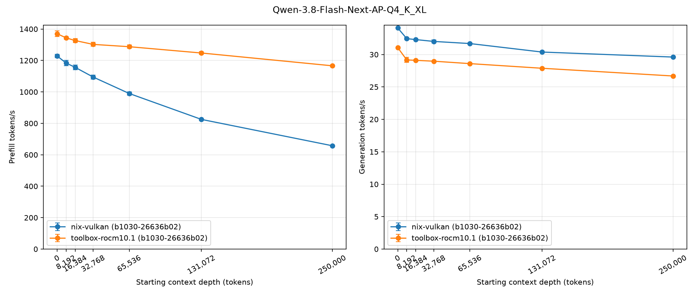
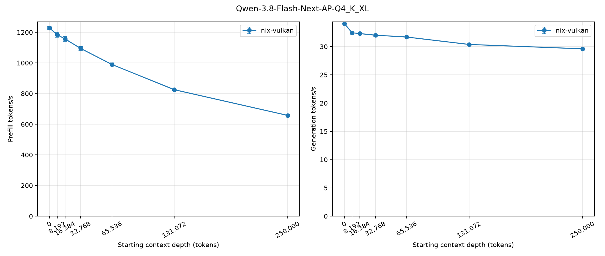

# llm-benchmark

Measure llama-server prefill and generation throughput across context depths, then plot the results.

Needs Python 3.14+ and matplotlib (`uv sync`).

## 1. Benchmark a running llama-server

`bench_llama_server.py` sweeps the starting context depths against a running server and writes one CSV
plus one Markdown report per model and build.

```bash
./bench_llama_server.py --url http://127.0.0.1:8080 --build-id nix-vulkan \
  --model Qwen-3.8-Flash-Next-AP-Q4_K_XL --api-key secret --output-dir results
```

## 2. Plot the reports

`plot_llama_server_bench.py` renders one PNG per model.

```bash
./plot_llama_server_bench.py --output-dir graphs results/*.csv
```

To put two builds of the same model on a single figure, name their reports:

```bash
./plot_llama_server_bench.py --compare-builds \
  results/qwen-3.8-flash-next-ap-q4_k_xl__nix-vulkan.csv \
  results/qwen-3.8-flash-next-ap-q4_k_xl__toolbox-rocm10.1.csv \
  --output-dir graphs
```

## Example

Qwen-3.8-Flash-Next-AP-Q4_K_XL, both builds on one figure:



A single benchmark run:



Reports: [nix-vulkan](examples/qwen-3.8-flash-next-ap-q4_k_xl__nix-vulkan.md),
[toolbox-rocm10.1](examples/qwen-3.8-flash-next-ap-q4_k_xl__toolbox-rocm10.1.md) ·
Data: [nix-vulkan](examples/qwen-3.8-flash-next-ap-q4_k_xl__nix-vulkan.csv),
[toolbox-rocm10.1](examples/qwen-3.8-flash-next-ap-q4_k_xl__toolbox-rocm10.1.csv)

## Help

```
usage: bench_llama_server.py [-h] [--url URL] --build-id BUILD_ID
                             --model MODEL [--output-dir OUTPUT_DIR]
                             [--depths DEPTHS]
                             [--prefill-tokens PREFILL_TOKENS]
                             [--generation-tokens GENERATION_TOKENS]
                             [--repetitions REPETITIONS] [--seed SEED]
                             [--timeout TIMEOUT] [--api-key API_KEY]
                             [--build-info BUILD_INFO]
                             [--log-level {DEBUG,INFO,WARNING,ERROR}]

Benchmark llama-server prefill and generation throughput.

options:
  -h, --help            show this help message and exit
  --url URL             llama-server base URL
  --build-id BUILD_ID   series label of this build
  --model MODEL         model preset name
  --output-dir OUTPUT_DIR
                        directory for the report pair
  --depths DEPTHS       comma-separated starting depths
  --prefill-tokens PREFILL_TOKENS
  --generation-tokens GENERATION_TOKENS
  --repetitions REPETITIONS
  --seed SEED
  --timeout TIMEOUT
  --api-key API_KEY     Bearer token for the server
  --build-info BUILD_INFO
                        override the reported llama.cpp build info (the server
                        reports a placeholder like 'b0-unknown' when the
                        binary was built without git metadata)
  --log-level {DEBUG,INFO,WARNING,ERROR}
                        logging verbosity (DEBUG also prints the raw server
                        timings)
```

```
usage: plot_llama_server_bench.py [-h] [--output-dir OUTPUT_DIR]
                                  [--log-level {DEBUG,INFO,WARNING,ERROR}]
                                  [--compare-builds REPORT_A REPORT_B]
                                  [reports ...]

Plot llama-server benchmark reports as comparison graphs.

positional arguments:
  reports               per-model report CSV paths

options:
  -h, --help            show this help message and exit
  --output-dir OUTPUT_DIR
                        directory for the PNG files
  --log-level {DEBUG,INFO,WARNING,ERROR}
                        logging verbosity
  --compare-builds REPORT_A REPORT_B
                        plot the two builds described by these report CSVs
                        onto a single figure
```
